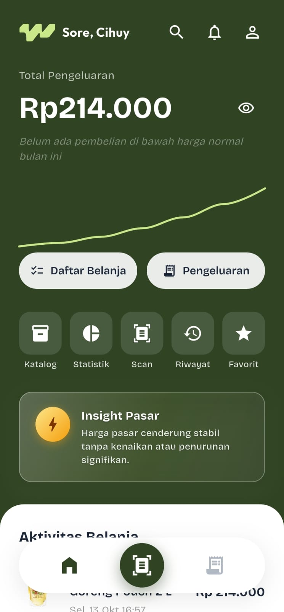
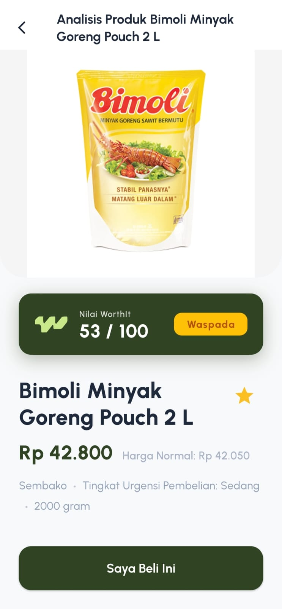
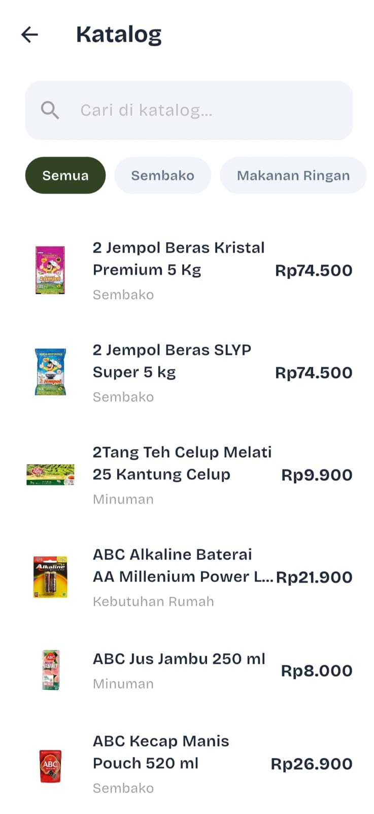
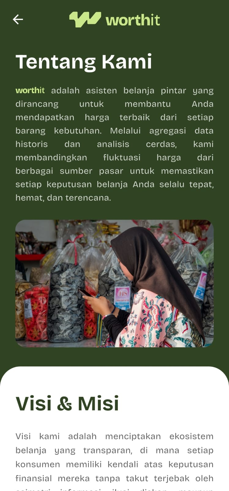
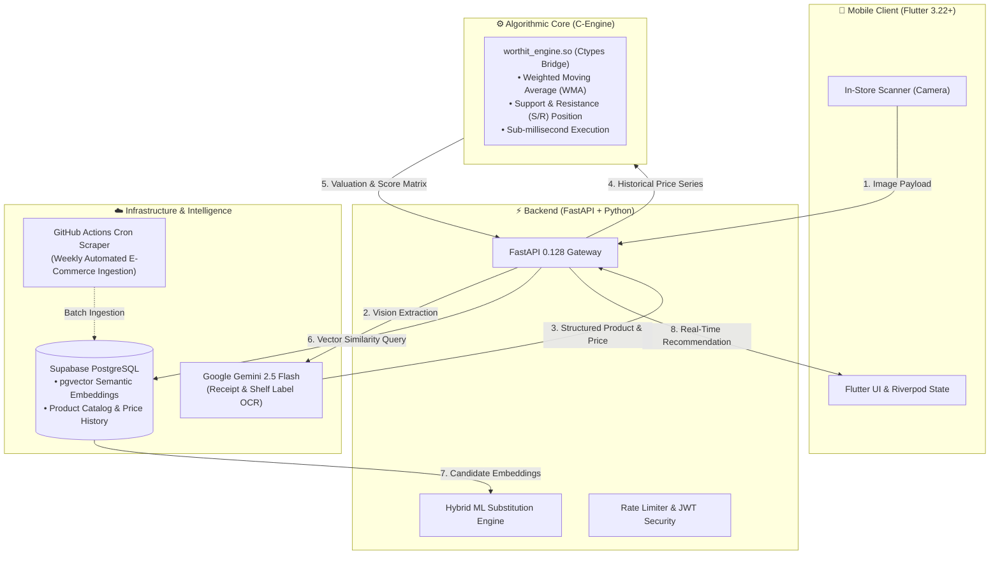

<div align="center">
  
  <br/><br/>
  <h1>WorthIt</h1>
  <p><strong>Real-Time Shopping Decision Validation Assistant</strong></p>
  <p>
    
    
    
    
    
    
  </p>
</div>

---

## Overview

**WorthIt** is a mobile application designed to assist consumers in validating shopping decisions in real-time while in-store. By scanning receipts or price tags, the system evaluates whether a product's price is **Worth It** (Fair), **Caution** (Slightly High), or **Expensive** — based on historical pricing data processed using Weighted Moving Average (WMA) and Support/Resistance algorithms.

### Key Features

| Feature | Description |
|---------|-------------|
| OCR Scan | Instant receipt and price tag scanning via Gemini Vision AI |
| Price Analysis | Real-time BUY / SUBSTITUTE / DONT_BUY decision engine backed by WMA |
| Shopping List | Monthly shopping lists with dynamic budget estimations |
| Expense Tracker | Categorized spending history and analytics |
| Favorites | Saved product tracking with historical price monitoring |
| Push Notifications | In-app alerts for price changes and product updates |

---

## 📱 Application Showcase

> 🛒 **Live In-Store Consumer Experience:**
> *WorthIt assists buyers at the point of purchase by transforming receipt and price-tag scans into instant valuation decisions, historical price trends, and contextual substitutions.*

| 1. Welcome & Onboarding | 2. Main Dashboard | 3. Real-Time Price Decision | 4. Supermarket Catalog | 5. Mission & Transparency |
|:---:|:---:|:---:|:---:|:---:|
|  |  |  |  |  |
| *Tagline & Google Sign-In* | *Expense tracking & market pulse* | *WMA valuation & Caution badge* | *Indexed supermarket products* | *Consumer price advocacy* |

---

## System Architecture



---

## 🔬 Engineering Highlights & Benchmarks

WorthIt is engineered for real-time in-store decision making with low-latency algorithmic guarantees and data fidelity:

### 1. High-Performance C-Engine (`worthit_engine.c`)
Pricing time-series evaluations (Weighted Moving Average and Support/Resistance ladder calculations) are executed in a native compiled **C shared library (`worthit_engine.so`)** bridged via Python `ctypes`:
- **Latency:** Sub-millisecond execution (< 0.01 ms per time-series evaluation).
- **Zero Overhead:** Eliminates Python interpreter overhead on recursive floating-point array operations.
- **Portability:** Built within a multi-stage Docker container for reliable production parity.

### 2. Hybrid ML Substitution Pipeline
When a scanned item is categorized as **Expensive** or **Caution**, the system suggests contextually relevant and more affordable alternatives. Rather than relying on naive keyword matching, WorthIt utilizes **PostgreSQL `pgvector` semantic similarity** bounded by deterministic category guardrails:

| Metric | Legacy / Baseline | WorthIt ML Hybrid | Engineering Impact |
|--------|-------------------|-------------------|--------------------|
| **Average Savings Realized** | 12.42% | **29.83%** | **+17.41% higher budget savings** |
| **Cross-Category Errors** | 0 | **0** | **0% false substitutions (Strict Category Fence)** |
| **Size & Quantity Similarity** | 0.41 | **0.62** | **+50.8% better portion/size accuracy** |
| **End-to-End Latency** | 417 ms | 621 ms | High semantic fidelity within interactive UX budget |

### 3. Resilient OCR Extraction
- Handles distorted, unevenly lit, and crumpled receipts using structured JSON output prompts with Gemini 2.5 Flash.
- Automated fallback and rate-limit recovery mechanisms ensure the scanner interface remains responsive during high traffic.

---

## 📚 Technical Documentation & Specs

For comprehensive engineering specifications, architectural roadmaps, and testing methodology, refer to the following documents in [`docs/`](docs/):

- 📘 [Android Release & Keystore Guide](docs/ANDROID_RELEASE_GUIDE.md) — Production build, app signing, Sentry integration, and Google Play SOP.
- 📊 [Backtest Academic Plan](docs/BACKTEST_ACADEMIC_PLAN.md) — Algorithmic backtesting framework and validation methodology.
- 🏗️ [Infrastructure Upgrade Plan](docs/INFRASTRUCTURE_UPGRADE_PLAN.md) — Scalability specifications, containerization, and cloud topologies.
- 🧪 [Usability Testing Plan](docs/USABILITY_TESTING_PLAN.md) — User experience research methodology and acceptance criteria.

---

## System Requirements

### Prerequisites for All Team Members

| Component | Minimum Version | Notes |
|-----------|-----------------|-------|
| Flutter SDK | 3.22+ | Install via [flutter.dev](https://docs.flutter.dev/get-started/install) |
| Dart SDK | 3.4+ | Bundled with Flutter SDK |
| Android SDK | API 21+ | via Android Studio |
| Git | Latest | |

### Prerequisites for Backend Developers

| Component | Minimum Version | Notes |
|-----------|-----------------|-------|
| WSL2 (Ubuntu 22.04+) | - | Required for running backend services |
| Python | 3.11+ | Installed inside WSL |
| pip / venv | Latest | Standard virtual environment tools |
| Microsoft Dev Tunnels CLI | Latest | [Install Dev Tunnels](https://learn.microsoft.com/en-us/azure/developer/dev-tunnels/get-started) |
| GCC (build tools) | - | Required for C-Engine compilation: `sudo apt install build-essential` |

---

## Getting Started

### Local Setup (Flutter Frontend)

**1. Clone the repository**
```bash
git clone https://github.com/chulopp/WorthIt.git
cd WorthIt/frontend
```

**2. Configure environment settings**

Create `local_config.dart` from the provided template:

```bash
cp lib/config/local_config.example.dart lib/config/local_config.dart
```

Update `lib/config/local_config.dart` with your Supabase credentials and backend API URL:

```dart
class LocalConfig {
  static const supabaseUrl = 'https://YOUR_PROJECT.supabase.co';
  static const supabaseAnonKey = 'sb_publishable_XXXX...';
  static const supabaseAuthRedirectUrl = 'com.example.worthit_app://login-callback';

  // Active Dev Tunnel URL
  static const apiBaseUrl = 'https://XXXX-XXXX.devtunnels.ms';
}
```

**3. Install dependencies and run**
```bash
flutter pub get
flutter run
```

---

### Backend Setup (Python / FastAPI in WSL2)

> [!IMPORTANT]
> The backend setup must be performed inside a **WSL2 terminal**, not Windows PowerShell.

**1. Navigate to backend directory inside WSL**
```bash
# In Windows PowerShell:
wsl

# Inside WSL:
cd /path/to/WorthIt/backend
```

**2. Setup virtual environment and install dependencies**
```bash
python3 -m venv .venv
source .venv/bin/activate
pip install -r requirements.txt
```

**3. Configure Environment Variables**

Copy the provided `.env.example` template:

```bash
cp .env.example .env
```

Update `.env` with your Supabase credentials and Gemini API key:

```env
SUPABASE_URL=https://YOUR_PROJECT.supabase.co
SUPABASE_SERVICE_ROLE_KEY=eyJhbG...
SUPABASE_JWT_SECRET=YOUR_JWT_SECRET
GEMINI_API_KEY=AIza...
```

**4. Build the C-Engine shared library**
```bash
cd engine
gcc -shared -fPIC -o worthit_engine.so worthit_engine.c -lm
cd ..
```

**5. Start the API server**
```bash
uvicorn main:app --reload --host 0.0.0.0 --port 8000
```

The service will run at `http://localhost:8000`. Interactive API documentation is available at `http://localhost:8000/docs`.

---

### Docker Deployment (Alternative)

You can also run the backend using Docker, which automatically compiles the C-Engine:

```bash
# Build the Docker image
docker build -t worthit-backend .

# Run the container
docker run -p 8000:8000 --env-file backend/.env worthit-backend
```

---

### Exposing Backend via Microsoft Dev Tunnels

To enable physical Android devices to communicate with the local backend running in WSL:

**1. Log in to Dev Tunnels**
```bash
devtunnel user login
```

**2. Start hosting port 8000**
```bash
devtunnel host -p 8000 --allow-anonymous
```

Copy the generated URL (e.g., `https://XXXX-8000.devtunnels.ms`) and update `apiBaseUrl` in `local_config.dart`.

---

## Project Structure

```
WorthIt/
├── docs/                       # Android release guide & infrastructure specs
├── frontend/                   # Flutter Mobile Application
│   └── lib/
│       ├── config/             # Environment & API configurations
│       ├── controllers/        # State management (Riverpod Notifiers)
│       ├── models/             # Data models & DTOs
│       ├── repositories/       # Data access layer
│       ├── screens/            # UI screens & views
│       ├── services/           # Authentication, Notifications, Privacy
│       ├── utils/              # PDF generation, Snackbar, Image helpers
│       └── widgets/            # Reusable UI components
│
├── backend/                    # FastAPI Backend Service
│   ├── core/                   # Security (JWT), Categories, Embedding Engine
│   ├── engine/                 # C-Engine bindings, WMA scoring, Similarity
│   ├── models/                 # Pydantic schemas
│   ├── routers/                # API Endpoints (Analysis, Scan, Shopping, etc.)
│   ├── scripts/                # Price scrapers, Embeddings generation, Benchmarks
│   ├── utils/                  # Supabase client singleton
│   ├── main.py                 # FastAPI application entrypoint
│   └── requirements.txt
│
└── supabase/migrations/        # SQL Migration scripts (Database schemas & pgvector)
```

---

## Database Architecture

WorthIt utilizes **Supabase (PostgreSQL)** for data storage. Primary tables include:

| Table | Description |
|-------|-------------|
| `users` | User profiles, subscription tier, and monthly budget settings |
| `products` | Product catalog and metadata |
| `price_history` | Historical price tracking per product |
| `scan_history` | Receipt and price tag scan logs |
| `purchase_history` | Verified user purchase records |
| `monthly_shopping_lists` | User monthly shopping lists |
| `shopping_list_items` | Individual items in shopping lists |
| `favorite_products` | Bookmarked products for price monitoring |
| `notifications` | In-app notification delivery log |

---

## Team Onboarding

1. **Clone** the repository.
2. Request necessary environment credentials from project leads (`backend/.env` & Supabase keys).
3. Follow **Local Setup** instructions above.
4. For frontend-only development, connect to an active Dev Tunnel endpoint without launching a local backend instance.

---

## Project Status

| Component | Status |
|-----------|--------|
| Flutter Frontend | ✅ Completed |
| FastAPI Backend | ✅ Completed |
| C-Engine (Scoring Algorithm) | ✅ Completed |
| ML Substitution Engine | ✅ Completed |
| Alfagift Price Scraper | ✅ Completed |
| OCR (Gemini Vision AI) | ✅ Completed |
| Supabase Auth (Google Sign-In) | ✅ Completed |
| Shopping List Module | ✅ Completed |
| Expense Tracker Module | ✅ Completed |
| Push Notifications | ✅ Completed |
| Production Deployment Setup | ✅ Completed |

---

## Security Guidelines

- **Never commit environment configuration files (`backend/.env` or `local_config.dart`) to source control.**
- Keep Dev Tunnel endpoints confidential during active development sessions.
- Ensure production environments enforce strict JWT signature verification.

---

## Team & Contact

Developed and maintained with ❤️ by the **WorthIt Team**.

For questions, feedback, or inquiries, please open an [Issue](https://github.com/chulopp/WorthIt/issues).

---

## License

Copyright © 2026 WorthIt Team. All Rights Reserved.

This project is proprietary software. Unauthorized copying, distribution, or modification of any part of this repository is strictly prohibited. See [LICENSE](LICENSE) for details.
